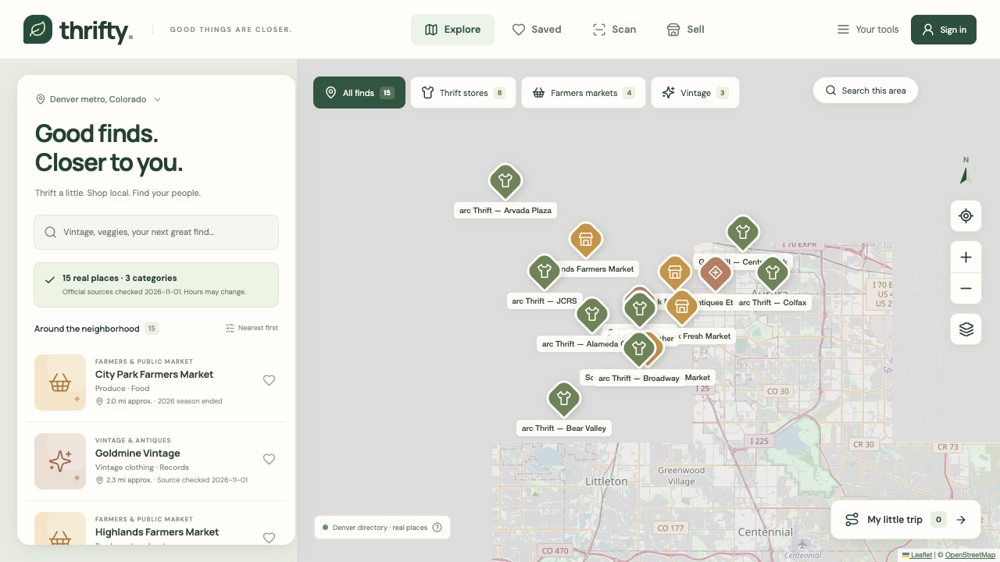

# Thrifty

[](https://github.com/robs46859-eng/thrifty/actions/workflows/ci.yml)

**Good things are closer.** A mobile-first map for thrift shoppers, farmers market customers and local sellers, with scanning, household shopping and resale tools close at hand.

**Live app:** [worklifelm.com](https://worklifelm.com/) · **Hosting:** Hostinger Node.js / Express · **Release branch:** `main`

Explore nearby places, keep favorites, plan a little trip and preview a seller pin. The default Denver map contains 20 real listings across thrift stores, farmers markets and vintage/antique shops, with official sources and review dates. Eight additional Denver-metro areas are marked **directory ready** in the city selector with 10 or 11 reviewed listings each and at least three per category. Shared venues keep one map identity and their actual municipality/address. Wider OpenStreetMap discovery is best effort. Seller pins are private device drafts, not public listings. The fleece, lamp and pet gear scanner examples are also fictional. Uploaded photos never receive fabricated identification or prices.



[Current cities](#current-cities) · [Community reports](#community-reports) · [Deployment](#deployment) · [Repeat for another US city](docs/CITY_WORKFLOW.md) · [Real data & sources](docs/DATA.md) · [Map guide](docs/MAP.md) · [Quick start](#quick-start) · [First find](#try-your-first-find) · [Features](#what-works) · [Sign-in setup](docs/AUTHENTICATION.md) · [AI setup](#optional-image-analysis) · [Marketplace status](#marketplace-limitations) · [Validation](#validation) · [Project structure](#project-structure)

## Current cities

These source-reviewed directories are bundled with the app and served by the API without a third-party places lookup. Choose a city marked **directory ready** in the city selector. Denver is the default.

| City / regional coverage   | Thrift stores | Farmers markets | Vintage / antiques | Listings | Source review date |
| -------------------------- | ------------: | --------------: | -----------------: | -------: | ------------------ |
| Denver metro, Colorado     |            13 |               4 |                  3 |       20 | November 1–2, 2026 |
| Arvada area, Colorado      |             5 |               3 |                  3 |       11 | November 1–2, 2026 |
| Aurora area, Colorado      |             5 |               3 |                  3 |       11 | November 1–2, 2026 |
| Boulder area, Colorado     |             4 |               3 |                  3 |       10 | November 1–2, 2026 |
| Centennial area, Colorado  |             5 |               3 |                  3 |       11 | November 1–2, 2026 |
| Englewood area, Colorado   |             5 |               3 |                  3 |       11 | November 1–2, 2026 |
| Lakewood area, Colorado    |             5 |               3 |                  3 |       11 | November 1–2, 2026 |
| Littleton area, Colorado   |             5 |               3 |                  3 |       11 | November 1–2, 2026 |
| Westminster area, Colorado |             4 |               3 |                  3 |       10 | November 1–2, 2026 |

There are **46 unique physical venues** across these nine catalogues. Nearby city areas overlap: shared venues retain one ID and their actual municipality/address, so the row totals must not be added as unique businesses. Discovery selects the nearest published city profile and filters its records within 20 km of the requested center. Seasonal markets can remain listed with explicit season-ended or future-season labels. Published review dates are not open-now or live-stock guarantees; records become overdue after 30 days.

Eight additional city directories were published November 2, 2026: **Dallas, Austin, San Antonio, Portland, Seattle, Kansas City (MO), Phoenix and Albuquerque**. Each adds **9 venues: 3 thrift, 3 farmers/public markets and 3 vintage/antique shops**, for **72 new venues and 118 unique venues across 17 profiles**. New Mexico coverage is Albuquerque only. Austin includes Cedar Park within its 30 km profile; the other profiles use 20 km. Unknown hours and market seasons remain unasserted; confirm the linked operator schedule before traveling. Pullman Market is an indoor food market, not a weekly farmers market. See [the directory sources and coverage notes](docs/DATA.md).

## Quick start

Requires Node **22.13+** and npm.

```sh
git clone https://github.com/robs46859-eng/thrifty.git
cd thrifty
npm ci
npm run dev
```

Open the Vite URL printed in the terminal (normally `http://127.0.0.1:5173`). The development API runs at `http://127.0.0.1:4317`; Vite proxies `/api` to it. Both bind to loopback by default.

For the production build and offline shell:

```sh
npm run build
npm start
```

Open `http://127.0.0.1:4317`. Installation and camera capture require HTTPS or localhost. On iOS, use Safari → Share → Add to Home Screen; on supporting desktop/Android browsers, use the install option. The in-app **Get the app** button uses the install prompt when available and otherwise gives instructions.

## Expand to another US city

Use the [city expansion workflow](docs/CITY_WORKFLOW.md) to repeat the Denver process in Colorado or other US states. It includes published Colorado examples, evidence-based publication, cached source/geocode requests, hard HTTP budgets and a [reusable research prompt](docs/CITY_RESEARCH_PROMPT.md). New cities enter discovery automatically only after their data is reviewed and published through the CLI. No recurring crawl is enabled. Current research limits are **8 web searches and 24 source-page reads per pass**, with CLI HTTP budgets of **20 requests per command and 60 per UTC day**. Source responses are cached for seven days and address geocodes for 365 days. See `research/limits.json` and the workflow guide for enforcement details.

An optional [low-cost model assistant](docs/CITY_MODEL_ASSIST.md) extracts pending proposals from registered cached pages using Gemini or local Ollama. Research runs accept any existing city plan, serialize shared usage, and preserve cached pages and budget ledgers across GitHub runs. `npm run city:readiness` reports remaining publication work. Approved batches use cached bulk geocoding, duplicate/non-retail checks, a dry run and full publication validation before staging. The eight requested expansion cities are now published. No additional model calls were needed to promote this batch.

## Explore your neighborhood

1. Open **Explore** to pan and zoom the map. The first Denver view contains **20 real places in three categories**.
2. Tap **Search this area** or the location button to search near a map center. All nine published city directories work without a places API key or external lookup. Outside reviewed coverage, public discovery is best effort.
3. Filter by thrift stores, farmers/public markets, vintage, farm shops or local sellers; use the search box to narrow the current results.
4. Open a pin or place card, save it with the heart, and add it to **My little trip**. Public-place trips open directions in Google Maps. Sample mode is explicit and cannot launch real directions.
5. Open **Sell** to create a private shop/stall draft at your chosen map location. Other customers cannot see it yet.
6. Open a reviewed place → **Share an update** to contribute a public shopper observation. Sign in first; private purchases are never published automatically.
7. Open **Your tools** for household goals, merchant inventory, pricing, connections, backup and installation.

Read the [data guide](docs/DATA.md) for all three populated categories, source links, seasonal labels and the maintenance process, and the [map guide](docs/MAP.md) for seller boundaries, location privacy and trip behavior.

## Try your first find

1. Open **Scan a find** and try the fictional fleece, lamp or pet-gear sample, or upload your own photo. No AI credentials are needed for manual identification.
2. Choose **Merchant** or **Household** to see the relevant assessment. Review the item name, brand, size, condition, asking price and repair costs.
3. Check the review confirmation and save the item to the selected inventory.
4. In **Your household**, edit the starter profiles and shopping goals for yourself, children or pets. In **Merchant studio**, configure your shop and record inventory or actual sales.
5. Open **Pricing & listings** for a saved merchant item to add comparable evidence, prepare a local listing draft and export it for manual posting.
6. Use **Workspace** to export a JSON backup before clearing browser data or moving to another device. Open **Your tools → Workspace & backup** on desktop or mobile.

Changing the browser origin or port creates a separate workspace. Export from the original address and import at the new address to transfer your records.

## What works

- **Nine reviewed city directories:** Denver, Arvada, Aurora, Boulder, Centennial, Englewood, Lakewood, Littleton and Westminster, with published addresses, source links, checked dates, operator or approximate geocoded pins and season-ended/future-season labels. The [city table](#current-cities) lists category counts. Review dates become overdue after 30 days; fetching the app never renews them.
- **Interactive map:** pannable Leaflet map, color-coded selectable pins, category and text filters, public place search, explicit location permission, collapsible mobile place sheet, saved places, ordered trip stops and Google Maps directions for public destinations. See [map limitations](docs/MAP.md).
- **Community updates:** share restock/discount days, closures/reopenings, holiday hours, category price ranges, layout notes, ratings, parking, nearby finds and accessibility. Signed-in members can confirm, dispute, flag and withdraw reports; admin moderation and automatic expiry keep updates bounded. Map badges and filters show active reports. See [community features and limits](docs/COMMUNITY.md).
- **Seller map workspace:** create and delete private shop/stall pins with location, category, description and dates/hours; preserved in local backups. No public publishing is implied.
- **Scanning:** rear-camera capture input, separate photo-library upload, session photo preview, manual identification and editable details. JPEG/PNG/WebP up to 4 MB. Configure a provider for opt-in image labels and OCR. HEIC must be converted to a supported image format.
- **Purchase location tags:** select a reviewed map place or enter a store/market and address; carry the tag through scanning and photo upload, save it in household or merchant inventory, search it, edit/clear it and include it in private backups. No automatic GPS collection or public purchase history.
- **Dual assessment:** merchant score for profit, margin, condition, shop focus and real recorded sales from the same category/source; household score for shopping goals, size, budget including repairs, color, theme, urgency and owned duplicates. No matching goal or comparable means no invented score or valuation.
- **Household:** editable adult, child and pet profiles; goal creation/editing/deletion and completion; owner-linked inventory, search, profile filters and removal. Starter profiles and goals are explicitly examples. Goals preserve their own size/preferences rather than silently following profile changes.
- **Merchant studio:** current/planned shop name, focus and source store; editable target profit, minimum margin, shipping, labor and fee assumptions; inventory, search, stock/sold state, recorded sales and actual expenses. Sample sales never improve your performance statistics or history-based scoring.
- **Pricing:** user-entered sold/asking comparables with provenance, date, condition and optional source URL; median and range of positive sold prices from the last 90 days for the same category/brand/title/size and condition. Asking, stale, future, zero and mismatched evidence are excluded. No live market feed is implied.
- **Channel planner:** channel-specific sold medians where available, otherwise a labeled blended median; inventory-age markdowns and a target-profit floor. Suggestions recalculate from local evidence/settings and never automatically change external listings. One editable planning fee applies across channels, not a claim about their actual fee schedules.
- **Listing workspace:** save/edit/delete per-channel local drafts, manual price override, export text ready to copy into a marketplace. Recording a sale does not delist external listings.
- **Protected cloud scans:** Google sign-in and emailed one-time codes; server-enforced free allowance of 10 cloud scans per UTC day and 3 per rolling minute; verified `rob@virtuapet.com` is exempt from scan quotas. Private SQLite session/usage storage survives restarts and deployments. Sign-in requires its own configuration; the Vision API key alone does not enable it. See [sign-in setup](docs/AUTHENTICATION.md).
- **Durability:** schema-validated versioned device storage, JSON backup/export/import, explicit reset, quota/corruption warnings, offline app shell, local bundled fonts/icons. Bad saved data is preserved until you explicitly import or reset. Backups with duplicate IDs or orphaned records are rejected.
- **Integration contracts:** nine marketplace entries, typed adapter contracts, disconnected capability discovery and fail-closed publish/reprice endpoints. None is connected in this build.

## Community reports

Open a reviewed store or market → **Share an update** → sign in with Google or an emailed code. Public feeds are readable without an account. Reports are shared across users under a generated shopper alias; private inventory and purchase tags are never published automatically.

| Report                       | What shoppers can share                                            |
| ---------------------------- | ------------------------------------------------------------------ |
| Restock days                 | Recurring weekdays or a specific date, plus a time window          |
| Discount days                | Sale days/dates, time windows and discount details                 |
| Unlisted closure / reopening | Temporary closure, permanent closure or reopening observations     |
| Holiday hours                | A specific holiday date and hours, or Closed                       |
| Category price ranges        | A category and minimum/maximum prices in USD                       |
| Store layout                 | Text directions for an aisle, floor or section                     |
| Store rating                 | 1–5 stars and notes about the shopping experience                  |
| Parking                      | Areas, restrictions, costs and practical parking notes             |
| Nearby find                  | An item, optional category/price and the area where it was spotted |
| Accessibility                | Observed access information and relevant store areas               |

Map pins and place cards show active report badges. **Recent finds** and **Community updates** filter places in the current map results. Visible online map summaries refresh once per minute; place feeds also offer manual refresh. Reports carry observation and expiry dates and leave public feeds automatically when expired. Finds normally last two days; scheduled reports use their applicable date. Community ratings average one active rating per member per store. These are Thrifty ratings, not imported Google ratings or verified purchases.

Signed-in members can confirm or dispute another shopper's report, change/remove their vote, flag inaccurate/spam/private/abusive content, and withdraw their own reports. Three distinct member flags hide an update pending review. The verified admin can review flagged updates per place, hide, restore or remove them; moderation is audited. Free accounts can publish **10 reports per UTC day and 3 per minute**, with **60 feedback interactions per hour**. These are separate from cloud scan credits; the verified admin is exempt.

Community reporting currently covers the **46 reviewed venues**. Unreviewed OpenStreetMap results, fictional samples and private seller pins are excluded. Layout guidance is text only; floorplan/photo uploads, push notifications, merchant ownership verification and live inventory synchronization are not available. Reports are shopper observations, not official store notices or guaranteed availability. No test reports or invented ratings are seeded into production. Read [the community guide](docs/COMMUNITY.md) for expiry, moderation, storage and API details.

## Purchase location tags

On a place’s map details, tap **Found something good?** to carry that location into the scanner. You can also choose a listed purchase location or enter a store/market name and address in the scan form. Uploading a photo preserves your selected location. After saving, household and merchant inventory display **Purchased at** tags and optional directions. Use **Edit purchase location** to add, change or clear a saved item’s tag. Location terms are searchable in inventory and included in private backups. Older items without these fields remain supported. No GPS position is captured automatically; these are the purchase locations you record, stored in your account’s device workspace, not public item listings.

## Optional image analysis

Copy `.env.example` to `.env`, choose **one** provider, and restart the server:

```dotenv
VISION_PROVIDER=google
GOOGLE_VISION_API_KEY=your-server-side-key
```

Or:

```dotenv
VISION_PROVIDER=azure
AZURE_VISION_KEY=your-server-side-key
AZURE_VISION_ENDPOINT=https://your-resource.cognitiveservices.azure.com
```

The status endpoint exposes only provider availability, never credentials. A configured provider adds an opt-in checkbox on the scanner. Cloud requests require a verified sign-in and available allowance; missing sign-in configuration keeps them locked. The default is off. A new photo is sent through this server to the selected provider only when enabled. Without consent or connectivity it stays on-device; without valid credentials or on provider failure, identification falls back to manual input. Photos are not written to disk, inventory storage or service-worker caches; they are held in the current scanning view. Your cloud provider may retain requests under your account's data policy.

Google Cloud Vision's label detection/OCR and Azure Vision's tags/read endpoints are implemented. **Google Lens is not integrated.** These services suggest labels/text, not verified SKU, brand, authenticity, fit or market value. Confidence is labeled as a top-label score, not item certainty. The user must confirm all details before saving. Provider tests use mocked responses; no credentialed live call was verified.

Official references: [Google Vision](https://docs.cloud.google.com/vision/docs), [Azure Image Analysis REST usage](https://learn.microsoft.com/en-us/azure/ai-services/computer-vision/how-to/call-analyze-image-40?pivots=programming-language-rest-api).

## Marketplace limitations

| Channel                                                | Included now                      | Needed for live operation                                                                                    |
| ------------------------------------------------------ | --------------------------------- | ------------------------------------------------------------------------------------------------------------ |
| eBay                                                   | Draft/export and adapter contract | Developer app, seller OAuth, business policies, item/location/offer mapping, tested publish and update flows |
| Etsy                                                   | Draft/export and adapter contract | App access, shop OAuth/PKCE, taxonomy, eligibility and listing requirements                                  |
| Shopify                                                | Draft/export and adapter contract | Store installation, Admin API scopes, products/variants/inventory mapping                                    |
| WooCommerce                                            | Draft/export and adapter contract | Merchant store, REST credentials, product/inventory mapping                                                  |
| Poshmark, Mercari, Depop, Facebook Marketplace, Vinted | Draft/export                      | Manual posting; approved partner capability must be established before implementing automation               |

No connector stores tokens, runs OAuth, publishes, synchronizes orders, fetches sold comparables, or reprices externally. This is an extensible catalog, not every marketplace worldwide. See [integration architecture](docs/ARCHITECTURE.md) for the implementation boundary and next steps. Real-time and background pricing jobs are future work.

## Validation

```sh
npm run data:check      # Validate all published city directories
npm test               # Domain, storage, API and provider contracts
npm run build          # Type checking, client/server bundles, versioned offline shell
npm run test:e2e       # Desktop Chrome + emulated Pixel 7, production server
npm run test:runtime   # Hostinger-compatible compiled server startup
npm run format:check
```

Browser tests require Google Chrome (`npx playwright install chrome` if absent). Playwright starts an isolated loopback fixture server on port 4321, serves the production client build, captures email locally and never sends actual sign-in emails. Production startup is checked separately by the compiled-server regression test. CI installs Chrome, tests, builds, and runs the same browser suite. The current suite includes **81 domain/API tests**, **40 desktop/phone browser workflows** and a compiled-server startup regression. Coverage includes all nine city directories, purchase tags, review/save/draft/export/sale/persistence, photo upload with manual fallback, comparables, household profiles/goals, offline reload/save, account separation, cloud scan quotas, community sharing/voting/flags, admin moderation, expiry, ratings and layout overflow. There is no physical phone camera, iOS installation, real Google consent, live SMTP delivery, provider billing or live marketplace acceptance verification from fixture tests alone.

## Storage and hosting boundary

Sign-in protects cloud scanning and separates browser-local account workspaces. There is **no shared household membership, cloud inventory database, cross-device inventory sync or automatic backup**. Server-side identities, sessions and scan counters are stored privately in SQLite; shared community reports, feedback and moderation records use that same private database. Inventory and photos are not stored there. Device workspace data belongs to the browser origin and may be lost when browser storage is cleared; export regularly. Shared community reports are server data: workspace backups and reset do not export or remove them; authors withdraw their posts separately. Photos are not durable. Hash navigation and local tools work on a static host, but sign-in, shared community reports, server discovery and optional AI need this Node server or a compatible backend. The production service worker caches only the same-origin app shell/assets, never API responses or photos. Updates wait for the user to save their current find and reload.

The Node server supports multiple verified accounts for sign-in, scan quotas and shared community reports; each account still has a separate device-local inventory workspace. Configure and verify sign-in and mail delivery before enabling paid cloud analysis. Authentication and durable per-user quotas are enforced on cloud requests; payment collection and extra paid usage are not implemented. For a deliberate deployment behind HTTPS, set `HOST`, `PORT`, and exact `APP_ORIGIN` as needed; update the Vite proxy if changing the API port in development. Running the build does not deploy the app. See [Hostinger deployment](docs/HOSTINGER.md) for hosting settings and live verification.

## Deployment

The app is hosted at **[worklifelm.com](https://worklifelm.com/)** on Hostinger. Git auto-deployment tracks `robs46859-eng/thrifty` branch **`main`**. Hostinger builds with `npm run build` and starts the compiled **`server.cjs`** entry point on Node.js 22. A push starts a build; wait for deployment completion before treating a revision as live.

Check [health](https://worklifelm.com/api/health) and [integration status](https://worklifelm.com/api/status) after a release. Health returns a source fingerprint so the hosted artifact can be matched to the build log; a documentation-only commit can keep the same source fingerprint. `authenticationConfigured: true` means sign-in storage/configuration initialized, and `communityStorage: "shared-sqlite"` means the shared report store initialized. Neither proves a real customer's Google login, email delivery or paid Vision request. The separate `storage: "device-only"` field describes inventory, not shared reports. Marketplace status remains `disconnected`.

At the November 1, 2026 live status check, identification was **manual**, authentication was configured, shared community storage was available and marketplaces were disconnected. A configured API key alone does not switch the identification provider or prove a successful paid request.

Set credentials in Hostinger's **server environment variables**, never in this README, committed `.env` files or `VITE_` variables. Google sign-in uses `GOOGLE_AUTH_CLIENT_ID`; emailed codes use the `SMTP_*` settings; optional identification uses the Google/Azure Vision settings above. Keep the private SQLite database outside deployment folders so accounts, counters and community reports survive releases. Full setup and acceptance steps are in [Hostinger deployment](docs/HOSTINGER.md) and [authentication setup](docs/AUTHENTICATION.md).

After an app update, save any current find before using **reload the app** when prompted. The service worker waits instead of replacing an in-progress scan.

## Project structure

| Path                       | Purpose                                                                   |
| -------------------------- | ------------------------------------------------------------------------- |
| `src/components/`          | Map, community, scanner, household, merchant, pricing and listing screens |
| `src/lib/model.ts`         | Shared schemas and data types                                             |
| `src/lib/scoring.ts`       | Household matching, resale scoring and comparable filtering               |
| `src/lib/marketplaces.ts`  | Channel price planning and disconnected marketplace adapter contracts     |
| `src/lib/storage.ts`       | Device persistence, backup validation and exports                         |
| `src/lib/community.ts`     | Public report schemas, report types and expiry rules                      |
| `src/lib/catalogue.ts`     | Shared reviewed venue catalogue and city selection                        |
| `data/`                    | Published Denver and other city directories                               |
| `research/`                | City plans, evidence, handoffs and usage budgets                          |
| `server/community*.ts`     | Shared report API, SQLite persistence, feedback and moderation            |
| `server/`                  | Sign-in, scan protection, discovery, image analysis and production server |
| `public/`                  | PWA manifest and app icons                                                |
| `scripts/build-sw.mjs`     | Production offline-shell generation                                       |
| `scripts/city-assist.ts`   | Bounded Gemini/Ollama extraction into pending city proposals              |
| `tests/`                   | Logic, storage, API and browser workflow tests                            |
| `.github/workflows/ci.yml` | Automated validation on pushes and pull requests                          |

Read the [architecture and integration guide](docs/ARCHITECTURE.md) for scoring formulas and live-adapter requirements, and the [validation record](docs/VALIDATION.md) for the tested scope and remaining verification limits.
