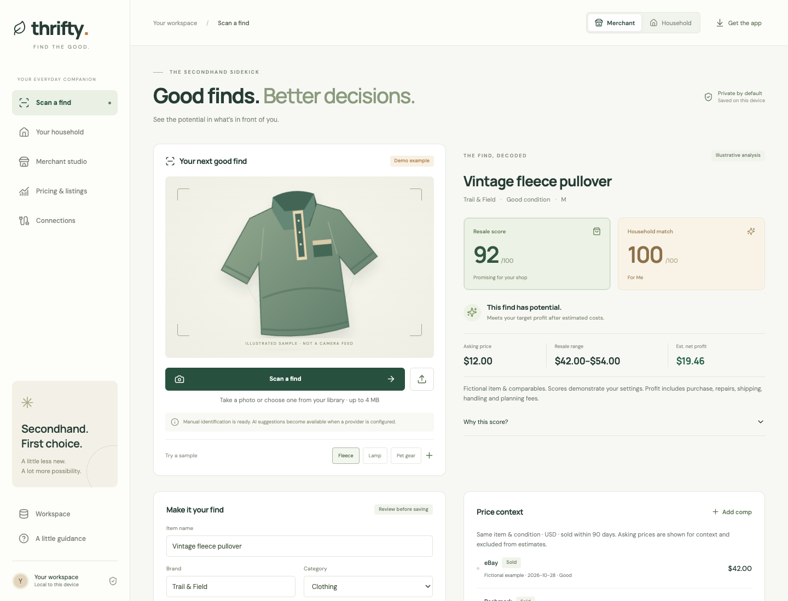

# Thrifty

[](https://github.com/robs46859-eng/thrifty/actions/workflows/ci.yml)

**Find the good.** A mobile-first, local-first Progressive Web App for intentional secondhand shopping and resale.

This repository contains a working app, not a live marketplace service. The initial fleece, lamp and pet gear are illustrated fictional samples. Uploaded photos never receive fabricated identification or prices.



[Quick start](#quick-start) · [First find](#try-your-first-find) · [Features](#what-works) · [Sign-in setup](docs/AUTHENTICATION.md) · [AI setup](#optional-image-analysis) · [Marketplace status](#marketplace-limitations) · [Validation](#validation) · [Project structure](#project-structure)

## Quick start

Requires Node **22.13+** and npm.

```sh
git clone https://github.com/robs46859-eng/thrifty.git
cd thrifty
npm ci
npm run dev
```

Open the Vite URL printed in the terminal (normally `http://127.0.0.1:5173`). The development API runs at `http://127.0.0.1:4317`; Vite proxies `/api` to it. Both bind to loopback by default.

For the production build and offline shell:

```sh
npm run build
npm start
```

Open `http://127.0.0.1:4317`. Installation and camera capture require HTTPS or localhost. On iOS, use Safari → Share → Add to Home Screen; on supporting desktop/Android browsers, use the install option. The in-app **Get the app** button uses the install prompt when available and otherwise gives instructions.

## Try your first find

1. Open **Scan a find** and try the fictional fleece, lamp or pet-gear sample, or upload your own photo. No AI credentials are needed for manual identification.
2. Choose **Merchant** or **Household** to see the relevant assessment. Review the item name, brand, size, condition, asking price and repair costs.
3. Check the review confirmation and save the item to the selected inventory.
4. In **Your household**, edit the starter profiles and shopping goals for yourself, children or pets. In **Merchant studio**, configure your shop and record inventory or actual sales.
5. Open **Pricing & listings** for a saved merchant item to add comparable evidence, prepare a local listing draft and export it for manual posting.
6. Use **Workspace** to export a JSON backup before clearing browser data or moving to another device. On phones, the workspace control is the database icon in the top bar.

Changing the browser origin or port creates a separate workspace. Export from the original address and import at the new address to transfer your records.

## What works

- **Scanning:** rear-camera capture input, separate photo-library upload, session photo preview, manual identification and editable details. JPEG/PNG/WebP up to 4 MB. Configure a provider for opt-in image labels and OCR. HEIC must be converted to a supported image format.
- **Dual assessment:** merchant score for profit, margin, condition, shop focus and real recorded sales from the same category/source; household score for shopping goals, size, budget including repairs, color, theme, urgency and owned duplicates. No matching goal or comparable means no invented score or valuation.
- **Household:** editable adult, child and pet profiles; goal creation/editing/deletion and completion; owner-linked inventory, search, profile filters and removal. Starter profiles and goals are explicitly examples. Goals preserve their own size/preferences rather than silently following profile changes.
- **Merchant studio:** current/planned shop name, focus and source store; editable target profit, minimum margin, shipping, labor and fee assumptions; inventory, search, stock/sold state, recorded sales and actual expenses. Sample sales never improve your performance statistics or history-based scoring.
- **Pricing:** user-entered sold/asking comparables with provenance, date, condition and optional source URL; median and range of positive sold prices from the last 90 days for the same category/brand/title/size and condition. Asking, stale, future, zero and mismatched evidence are excluded. No live market feed is implied.
- **Channel planner:** channel-specific sold medians where available, otherwise a labeled blended median; inventory-age markdowns and a target-profit floor. Suggestions recalculate from local evidence/settings and never automatically change external listings. One editable planning fee applies across channels, not a claim about their actual fee schedules.
- **Listing workspace:** save/edit/delete per-channel local drafts, manual price override, export text ready to copy into a marketplace. Recording a sale does not delist external listings.
- **Protected cloud scans:** Google sign-in and emailed one-time codes; server-enforced free allowance of 10 cloud scans per UTC day and 3 per rolling minute; verified `rob@virtuapet.com` is exempt from scan quotas. Private SQLite session/usage storage survives restarts and deployments. Sign-in requires its own configuration; the Vision API key alone does not enable it. See [sign-in setup](docs/AUTHENTICATION.md).
- **Durability:** schema-validated versioned device storage, JSON backup/export/import, explicit reset, quota/corruption warnings, offline app shell, local bundled fonts/icons. Bad saved data is preserved until you explicitly import or reset. Backups with duplicate IDs or orphaned records are rejected.
- **Integration contracts:** nine marketplace entries, typed adapter contracts, disconnected capability discovery and fail-closed publish/reprice endpoints. None is connected in this build.

## Optional image analysis

Copy `.env.example` to `.env`, choose **one** provider, and restart the server:

```dotenv
VISION_PROVIDER=google
GOOGLE_VISION_API_KEY=your-server-side-key
```

Or:

```dotenv
VISION_PROVIDER=azure
AZURE_VISION_KEY=your-server-side-key
AZURE_VISION_ENDPOINT=https://your-resource.cognitiveservices.azure.com
```

The status endpoint exposes only provider availability, never credentials. A configured provider adds an opt-in checkbox on the scanner. Cloud requests require a verified sign-in and available allowance; missing sign-in configuration keeps them locked. The default is off. A new photo is sent through this server to the selected provider only when enabled. Without consent or connectivity it stays on-device; without valid credentials or on provider failure, identification falls back to manual input. Photos are not written to disk, inventory storage or service-worker caches; they are held in the current scanning view. Your cloud provider may retain requests under your account's data policy.

Google Cloud Vision's label detection/OCR and Azure Vision's tags/read endpoints are implemented. **Google Lens is not integrated.** These services suggest labels/text, not verified SKU, brand, authenticity, fit or market value. Confidence is labeled as a top-label score, not item certainty. The user must confirm all details before saving. Provider tests use mocked responses; no credentialed live call was verified.

Official references: [Google Vision](https://docs.cloud.google.com/vision/docs), [Azure Image Analysis REST usage](https://learn.microsoft.com/en-us/azure/ai-services/computer-vision/how-to/call-analyze-image-40?pivots=programming-language-rest-api).

## Marketplace limitations

| Channel                                                | Included now                      | Needed for live operation                                                                                    |
| ------------------------------------------------------ | --------------------------------- | ------------------------------------------------------------------------------------------------------------ |
| eBay                                                   | Draft/export and adapter contract | Developer app, seller OAuth, business policies, item/location/offer mapping, tested publish and update flows |
| Etsy                                                   | Draft/export and adapter contract | App access, shop OAuth/PKCE, taxonomy, eligibility and listing requirements                                  |
| Shopify                                                | Draft/export and adapter contract | Store installation, Admin API scopes, products/variants/inventory mapping                                    |
| WooCommerce                                            | Draft/export and adapter contract | Merchant store, REST credentials, product/inventory mapping                                                  |
| Poshmark, Mercari, Depop, Facebook Marketplace, Vinted | Draft/export                      | Manual posting; approved partner capability must be established before implementing automation               |

No connector stores tokens, runs OAuth, publishes, synchronizes orders, fetches sold comparables, or reprices externally. This is an extensible catalog, not every marketplace worldwide. See [integration architecture](docs/ARCHITECTURE.md) for the implementation boundary and next steps. Real-time and background pricing jobs are future work.

## Validation

```sh
npm test               # Domain, storage, API and provider contracts
npm run build          # Type checking, client/server bundles, versioned offline shell
npm run test:e2e       # Desktop Chrome + emulated Pixel 7, production server
npm run test:runtime   # Hostinger-compatible compiled server startup
npm run format:check
```

Browser tests require Google Chrome (`npx playwright install chrome` if absent). Playwright starts an isolated loopback fixture server on port 4321, serves the production client build, captures email locally and never sends actual sign-in emails. Production startup is checked separately by the compiled-server regression test. CI installs Chrome, tests, builds, and runs the same browser suite. Tests cover review/save/draft/export/sale/persistence, real photo upload with manual fallback, comparable entry, household profiles/goals, offline reload/save, honest connection states and layout overflow. There is no physical phone camera, iOS installation, real Google consent, live SMTP delivery, provider billing or live marketplace acceptance verification from fixture tests alone.

## Storage and hosting boundary

Sign-in protects cloud scanning and separates browser-local account workspaces. There is **no shared household membership, cloud inventory database, cross-device inventory sync or automatic backup**. Server-side identities, sessions and scan counters are stored privately in SQLite; inventory and photos are not stored there. Data belongs to the browser origin and may be lost when browser storage is cleared; export regularly. Photos are not durable. Hash navigation works on a static host, but optional AI needs this Node server or a compatible backend. The production service worker caches only the same-origin app shell/assets, never API responses or photos. Updates wait for the user to save their current find and reload.

The supplied API is for a single-user local deployment. Configure and verify sign-in and mail delivery before enabling paid cloud analysis. Authentication and durable per-user quotas are enforced on cloud requests; payment collection and extra paid usage are not implemented. For a deliberate deployment behind HTTPS, set `HOST`, `PORT`, and exact `APP_ORIGIN` as needed; update the Vite proxy if changing the API port in development. Running the build does not deploy the app. See [Hostinger deployment](docs/HOSTINGER.md) for hosting settings and live verification.

## Project structure

| Path                       | Purpose                                                               |
| -------------------------- | --------------------------------------------------------------------- |
| `src/components/`          | Scanner, household, merchant, pricing, listing and connection screens |
| `src/lib/model.ts`         | Shared schemas and data types                                         |
| `src/lib/scoring.ts`       | Household matching, resale scoring and comparable filtering           |
| `src/lib/marketplaces.ts`  | Channel price planning and disconnected marketplace adapter contracts |
| `src/lib/storage.ts`       | Device persistence, backup validation and exports                     |
| `server/`                  | Optional image-analysis API and production app server                 |
| `public/`                  | PWA manifest and app icons                                            |
| `scripts/build-sw.mjs`     | Production offline-shell generation                                   |
| `tests/`                   | Logic, storage, API and browser workflow tests                        |
| `.github/workflows/ci.yml` | Automated validation on pushes and pull requests                      |

Read the [architecture and integration guide](docs/ARCHITECTURE.md) for scoring formulas and live-adapter requirements, and the [validation record](docs/VALIDATION.md) for the tested scope and remaining verification limits.
